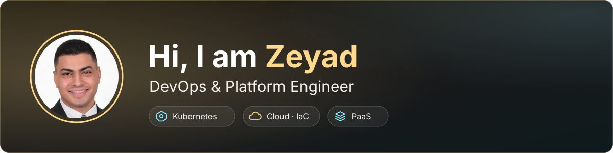

## ⚡ A Few Quick Facts

- 🧱 **A believer in the basics.** Invest the time to truly understand the fundamentals, and any new tool, technology or skill becomes something you can pick up fast.
- ✍️ **SEO technical writing.** Why? In short, writing has always been a hobby of mine. Check out my posts on [LinkedIn](https://www.linkedin.com/in/zeyad-elgammal0/).
- ☸️ Certified Kubernetes Administrator (CKA), working with cloud-native platforms, CI/CD and automation.
- 📄 Check out my [Résumé](https://drive.google.com/file/d/1zD5K12qtxY64jy6JbMN98BQKzm4f2FuD/view).

## 🖋️ Recent Posts

Explore

 

- [LinkedIn post](https://lnkd.in/p/eG3Z5Qa9)
- [LinkedIn post](https://lnkd.in/p/eqteMmWp)

[Read More](https://www.linkedin.com/in/zeyad-elgammal0/)

## 🚀 Technology Stack

  

